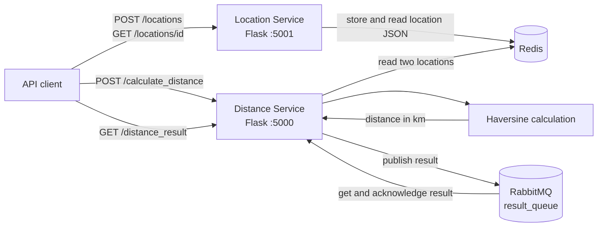

# GeoKapti Microservices

GeoKapti is a small backend system that registers geospatial locations and calculates the great-circle distance between exactly two stored points. It demonstrates service boundaries, API contracts, container orchestration, cache-backed data access, message delivery, input validation, and structured logging without presenting the demo stack as a production deployment.

## Problem and solution

Delivery and logistics systems often need a consistent way to identify locations before performing geospatial calculations. GeoKapti separates those concerns:

- The **Location Service** validates a name and coordinates, assigns a UUID, and stores the record in Redis.
- The **Distance Service** accepts two location IDs, reads both records from Redis, calculates their Haversine distance synchronously, and publishes the numeric result to RabbitMQ.
- A client retrieves the next queued result through the Distance Service. Successful reads are acknowledged so the same message is not returned again.

## Architecture



The services do not call each other over HTTP. Redis is their shared location store. RabbitMQ buffers calculated results, but the calculation itself runs in the HTTP request process rather than in a background worker.

### Request flow

1. A client sends two valid locations to `POST /locations`.
2. The Location Service stores each record in Redis and returns its UUID.
3. The client sends both UUIDs to `POST /calculate_distance`.
4. The Distance Service loads both records and calculates the Haversine distance in kilometers.
5. The service publishes the result to RabbitMQ queue `result_queue` and returns HTTP `202`.
6. The client calls `GET /distance_result`. The service returns and acknowledges the next queued result, or returns HTTP `204` when the queue is empty.

## Technology choices

| Technology | Role |
| --- | --- |
| Python 3.12 and Flask | Small HTTP services with explicit endpoints and straightforward request handling |
| Flask-Smorest, Marshmallow, and OpenAPI | Input validation, response serialization, generated OpenAPI contracts, and Swagger UI |
| Redis | Shared, low-latency storage for JSON location records |
| RabbitMQ and Pika | Queueing and acknowledged delivery of calculated results |
| Docker Compose | Reproducible local orchestration, dependency readiness, and loopback-only published ports |
| Poetry | Locked application and test dependencies |
| Structlog | Structured operational events without logging names or coordinates |

## Features

- UUID-based location registration and retrieval
- Latitude validation from `-90` to `90` and longitude validation from `-180` to `180`
- Haversine distance calculation for exactly two stored locations
- RabbitMQ result publication and acknowledged single-result retrieval
- OpenAPI 3.0.2 documents and interactive Swagger UI for both services
- Compose health checks for Redis, RabbitMQ, and both Flask services
- Two existing integration-flow tests, one for each service
- Configurable local ports and RabbitMQ credentials through an ignored `.env` file

## Project structure

```text
.
├── distance_service/
│   ├── test/
│   │   └── test_distance_app.py
│   ├── __init__.py
│   ├── app.py
│   ├── Dockerfile
│   └── start.sh
├── images/
│   ├── Captura de pantalla 2024-11-08 130927.png
│   └── Captura de pantalla 2024-11-08 130941.png
├── location_service/
│   ├── test/
│   │   └── test_location_app.py
│   ├── __init__.py
│   ├── app.py
│   ├── Dockerfile
│   └── start.sh
├── .dockerignore
├── .env.example
├── .gitattributes
├── .gitignore
├── docker-compose.yaml
├── poetry.lock
├── pyproject.toml
└── README.md
```

## Prerequisites

The verified setup requires:

- Docker Engine or Docker Desktop
- Docker Compose v2 (`docker compose`)
- Available default local ports `5000`, `5001`, `5672`, `6379`, and `15672`, or alternative values in `.env`

Python and Poetry are installed inside the service images. A fully host-native Redis/RabbitMQ setup has not been verified, so Docker Compose is the supported setup for this repository.

## Secure local configuration

Create a private environment file from the tracked template:

```bash
cp .env.example .env
```

PowerShell equivalent:

```powershell
Copy-Item .env.example .env
```

Change `RABBITMQ_PASSWORD` in `.env` before starting the stack. Keep `.env` private; it is excluded by `.gitignore`. The Compose file publishes all ports on `127.0.0.1`, not on every host interface. These controls are intended for local development and do not replace authentication, TLS, or network policy for a public deployment.

## Run with Docker Compose

Validate, build, and start the stack:

```bash
docker compose config --quiet
docker compose up -d --build --wait
docker compose ps
```

With the default ports, the interfaces are:

| Interface | URL |
| --- | --- |
| Distance Service Swagger UI | <http://127.0.0.1:5000/> |
| Distance Service OpenAPI JSON | <http://127.0.0.1:5000/openapi.json> |
| Location Service Swagger UI | <http://127.0.0.1:5001/> |
| Location Service OpenAPI JSON | <http://127.0.0.1:5001/openapi.json> |
| RabbitMQ management UI | <http://127.0.0.1:15672/> |

The Swagger pages load browser assets from jsDelivr, so rendering the interactive interface requires internet access. The JSON contracts remain available directly from each service.

## Tested API flow

The following PowerShell flow uses New York and Los Angeles and was exercised against the Compose stack:

```powershell
$headers = @{ "Content-Type" = "application/json" }

$first = Invoke-RestMethod -Method Post -Uri "http://127.0.0.1:5001/locations" `
  -Headers $headers -Body '{"name":"New York","latitude":40.7128,"longitude":-74.006}'

$second = Invoke-RestMethod -Method Post -Uri "http://127.0.0.1:5001/locations" `
  -Headers $headers -Body '{"name":"Los Angeles","latitude":34.0522,"longitude":-118.2437}'

Invoke-RestMethod -Method Get -Uri "http://127.0.0.1:5001/locations/$($first.id)"
Invoke-RestMethod -Method Get -Uri "http://127.0.0.1:5001/locations/$($second.id)"

$body = @{ location_ids = @($first.id, $second.id) } | ConvertTo-Json
Invoke-RestMethod -Method Post -Uri "http://127.0.0.1:5000/calculate_distance" `
  -Headers $headers -Body $body

Invoke-RestMethod -Method Get -Uri "http://127.0.0.1:5000/distance_result"
```

The verified result was approximately:

```json
{"total_distance": 3935.746254609723}
```

A second `GET /distance_result` returned HTTP `204`, confirming that the first delivery was acknowledged.

### API contract summary

| Method and path | Success | Relevant validation/error responses |
| --- | --- | --- |
| `POST /locations` | `201` with `{"id":"<uuid>"}` | `422` for missing or out-of-range fields |
| `GET /locations/{location_id}` | `200` with ID, name, latitude, and longitude | `404` when the ID does not exist |
| `POST /calculate_distance` | `202` after the result is queued | `400` unless exactly two IDs are supplied; `404` for an unknown ID; `422` for an invalid body |
| `GET /distance_result` | `200` with distance in kilometers | `204` when no result is available |

## Tests and verification

Run the existing tests inside the healthy containers:

```bash
docker compose exec -T location_service poetry run pytest -p no:cacheprovider -v --tb=short --maxfail=1 test
docker compose exec -T distance_service poetry run pytest -p no:cacheprovider -v --tb=short --maxfail=1 test
```

Latest local verification:

- Location Service: `1 passed`
- Distance Service: `1 passed`
- Both Swagger pages and both OpenAPI documents returned HTTP `200`
- The end-to-end New York/Los Angeles flow returned `3935.746254609723` km
- Invalid coordinates returned `422`; empty location IDs returned `400`; unknown IDs returned `404`; an empty result queue returned `204`

## Operations and cleanup

Compose health checks use `redis-cli ping`, `rabbitmq-diagnostics -q ping`, and each service's `/openapi.json` endpoint. Inspect status and logs with:

```bash
docker compose ps
docker compose logs --tail=100 location_service distance_service
```

Stop the project and remove its containers and network:

```bash
docker compose down --remove-orphans
```

Compose does not configure reusable application data volumes. Treat Redis and RabbitMQ data as disposable: after the cleanup command, a subsequent stack starts empty.

## Limitations and trade-offs

- Distance calculation is synchronous; RabbitMQ stores only the completed result.
- All clients share one uncorrelated result queue, so concurrent callers cannot reliably match a result to a request.
- Redis and RabbitMQ data are ephemeral in the current Compose setup.
- The services use Flask's development server, not a production WSGI server.
- The APIs have no client authentication, authorization, rate limiting, or TLS termination.
- There is no CI workflow; test results above come from the verified local Compose environment.
- Haversine calculates spherical great-circle distance, not road travel distance or a multi-stop route.

## Roadmap

Potential next steps, intentionally outside this repository hardening stage:

- Move calculations to a worker and add request/result correlation IDs.
- Add durable storage and explicit data lifecycle rules.
- Run the Flask applications behind a production WSGI server.
- Add CI for tests, dependency auditing, and Compose configuration validation.
